


  

<a href="https://www.linkedin.com/in/saqib-shouqi/"><picture>
    <source media="(prefers-color-scheme: dark)" srcset="./assets/btn-linkedin-dark.svg">
    <source media="(prefers-color-scheme: light)" srcset="./assets/btn-linkedin-light.svg">
    
  </picture></a>
<a href="https://www.kaggle.com/mohamedsaqibshouqi"><picture>
    <source media="(prefers-color-scheme: dark)" srcset="./assets/btn-kaggle-dark.svg">
    <source media="(prefers-color-scheme: light)" srcset="./assets/btn-kaggle-light.svg">
    
  </picture></a>
<a href="https://www.youtube.com/@DataSciencewithSaqib1"><picture>
    <source media="(prefers-color-scheme: dark)" srcset="./assets/btn-youtube-dark.svg">
    <source media="(prefers-color-scheme: light)" srcset="./assets/btn-youtube-light.svg">
    
  </picture></a>
<a href="https://scholar.google.com/citations?hl=en&user=2O32msoAAAAJ"><picture>
    <source media="(prefers-color-scheme: dark)" srcset="./assets/btn-scholar-dark.svg">
    <source media="(prefers-color-scheme: light)" srcset="./assets/btn-scholar-light.svg">
    
  </picture></a>
<a href="mailto:saqibshouqi@gmail.com"><picture>
    <source media="(prefers-color-scheme: dark)" srcset="./assets/btn-email-dark.svg">
    <source media="(prefers-color-scheme: light)" srcset="./assets/btn-email-light.svg">
    
  </picture></a>

  

<a href="#about"><b>About</b></a> &nbsp;&nbsp;·&nbsp;&nbsp;
<a href="#experience"><b>Experience</b></a> &nbsp;&nbsp;·&nbsp;&nbsp;
<a href="#projects"><b>Projects</b></a> &nbsp;&nbsp;·&nbsp;&nbsp;
<a href="#tech-stack"><b>Tech Stack</b></a> &nbsp;&nbsp;·&nbsp;&nbsp;
<a href="#research"><b>Research</b></a> &nbsp;&nbsp;·&nbsp;&nbsp;
<a href="#achievements"><b>Achievements</b></a> &nbsp;&nbsp;·&nbsp;&nbsp;
<a href="#connect"><b>Connect</b></a>

 

## About

I build AI systems that hold up beyond the demo. My work sits where **agentic AI**, **LLM orchestration**, **RAG pipelines** and **predictive analytics** meet full-stack engineering and system design, with the business acumen that comes from CIMA training.

At **Sysco Labs** I built a multi-agent AI Agile Coach, an AI-driven engineering analytics dashboard with forecasting, and core workflows for the company's enterprise agentic ecosystem. Alongside engineering, I publish research on agent evaluation, failure attribution and NLP-driven recommendation.

> [!NOTE]
> **Currently**
> - 🔬 Final-year research on **attribution-guided failure recovery for long-horizon LLM agents**
> - 🎓 BSc (Hons) AI &amp; Data Science, **RGU, UK** (awarded via IIT, Sri Lanka), graduating **2027**
> - 📈 **CIMA** Strategic Level in progress, with a perfect 150/150 in Financial Accounting

<picture>
    <source media="(prefers-color-scheme: dark)" srcset="./assets/metrics-dark.svg">
    <source media="(prefers-color-scheme: light)" srcset="./assets/metrics-light.svg">
    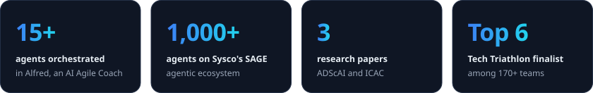
  </picture>

<picture>
    <source media="(prefers-color-scheme: dark)" srcset="./assets/focus-dark.svg">
    <source media="(prefers-color-scheme: light)" srcset="./assets/focus-light.svg">
    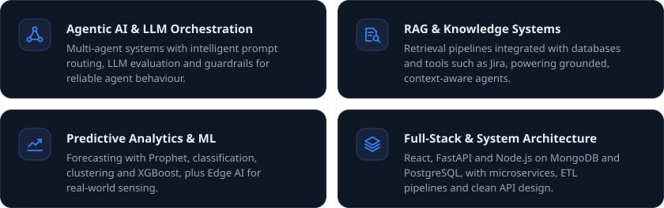
  </picture>

 

## Experience

<picture>
    <source media="(prefers-color-scheme: dark)" srcset="./assets/experience-dark.svg">
    <source media="(prefers-color-scheme: light)" srcset="./assets/experience-light.svg">
    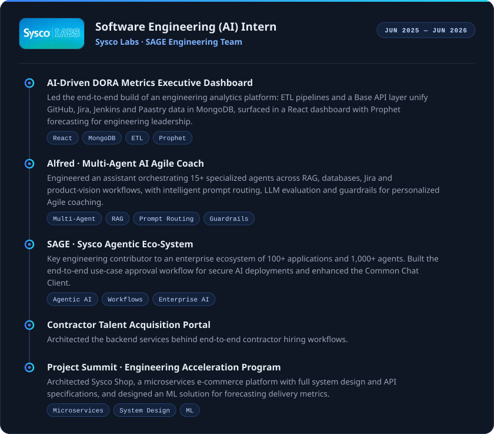
  </picture>

 

## Projects

<picture>
    <source media="(prefers-color-scheme: dark)" srcset="./assets/project-featured-dark.svg">
    <source media="(prefers-color-scheme: light)" srcset="./assets/project-featured-light.svg">
    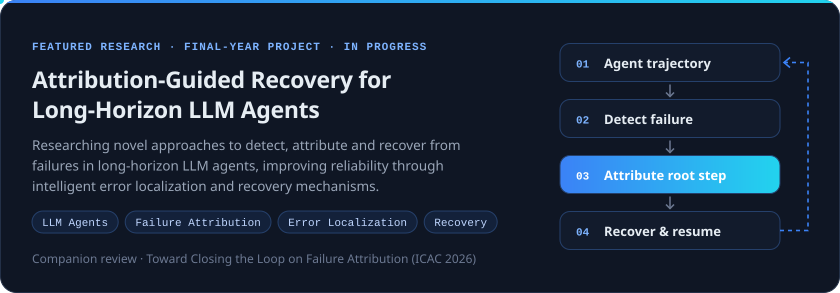
  </picture>

<a href="https://dl.lib.uom.lk/items/88fecb2e-25c6-464e-a39f-a7e0d191634f"><picture>
    <source media="(prefers-color-scheme: dark)" srcset="./assets/project-travelmate-dark.svg">
    <source media="(prefers-color-scheme: light)" srcset="./assets/project-travelmate-light.svg">
    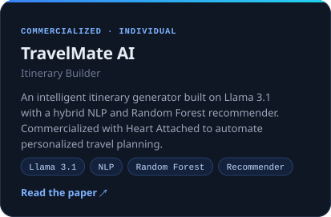
  </picture></a>
<picture>
    <source media="(prefers-color-scheme: dark)" srcset="./assets/project-pathwise-dark.svg">
    <source media="(prefers-color-scheme: light)" srcset="./assets/project-pathwise-light.svg">
    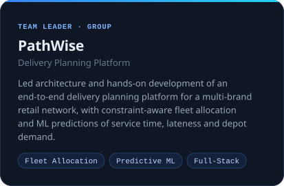
  </picture>

<a href="https://openreview.net/forum?id=IQckaFtB5L"><picture>
    <source media="(prefers-color-scheme: dark)" srcset="./assets/project-redteam-dark.svg">
    <source media="(prefers-color-scheme: light)" srcset="./assets/project-redteam-light.svg">
    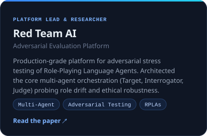
  </picture></a>
<picture>
    <source media="(prefers-color-scheme: dark)" srcset="./assets/project-govinetha-dark.svg">
    <source media="(prefers-color-scheme: light)" srcset="./assets/project-govinetha-light.svg">
    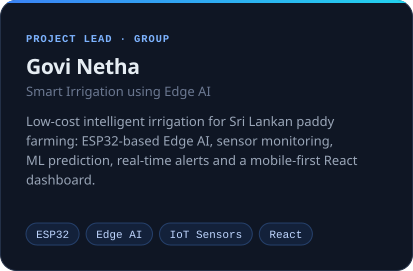
  </picture>

 

## Tech Stack

<picture>
  <source media="(prefers-color-scheme: dark)" srcset="https://skillicons.dev/icons?i=py%2Cjava%2Cjs%2Cts%2Cr%2Cpytorch%2Ctensorflow%2Csklearn%2Copencv%2Cfastapi%2Creact%2Cnodejs%2Cpostgres%2Cmongodb%2Cdocker%2Cgit%2Cgithubactions%2Cjenkins%2Caws%2Cazure%2Cgcp%2Cpostman&perline=11&theme=dark">
  
</picture>

  

<picture>
    <source media="(prefers-color-scheme: dark)" srcset="./assets/stack-dark.svg">
    <source media="(prefers-color-scheme: light)" srcset="./assets/stack-light.svg">
    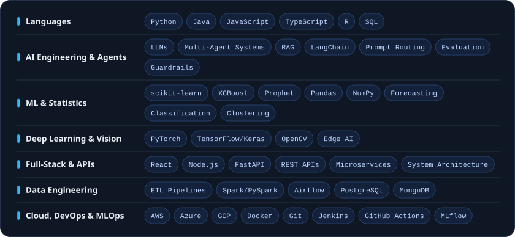
  </picture>

 

## Research

<a href="https://openreview.net/forum?id=IQckaFtB5L"><picture>
    <source media="(prefers-color-scheme: dark)" srcset="./assets/pub-redteam-dark.svg">
    <source media="(prefers-color-scheme: light)" srcset="./assets/pub-redteam-light.svg">
    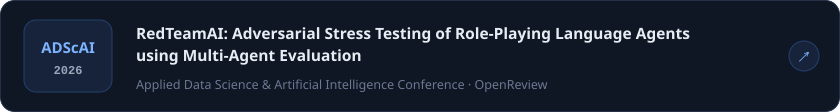
  </picture></a>

<picture>
    <source media="(prefers-color-scheme: dark)" srcset="./assets/pub-failure-dark.svg">
    <source media="(prefers-color-scheme: light)" srcset="./assets/pub-failure-light.svg">
    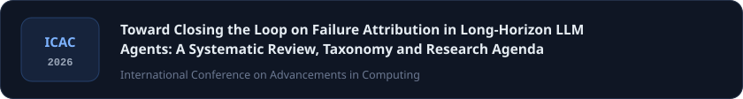
  </picture>

<a href="https://dl.lib.uom.lk/items/88fecb2e-25c6-464e-a39f-a7e0d191634f"><picture>
    <source media="(prefers-color-scheme: dark)" srcset="./assets/pub-travelmate-dark.svg">
    <source media="(prefers-color-scheme: light)" srcset="./assets/pub-travelmate-light.svg">
    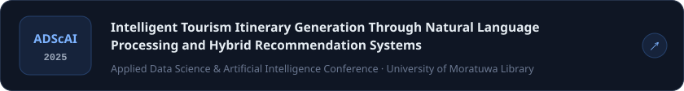
  </picture></a>

Full list on <a href="https://scholar.google.com/citations?hl=en&user=2O32msoAAAAJ"><b>Google Scholar</b></a>

 

## Achievements

<picture>
    <source media="(prefers-color-scheme: dark)" srcset="./assets/certs-dark.svg">
    <source media="(prefers-color-scheme: light)" srcset="./assets/certs-light.svg">
    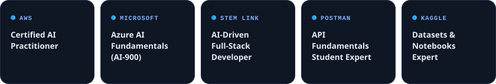
  </picture>

<picture>
    <source media="(prefers-color-scheme: dark)" srcset="./assets/comps-dark.svg">
    <source media="(prefers-color-scheme: light)" srcset="./assets/comps-light.svg">
    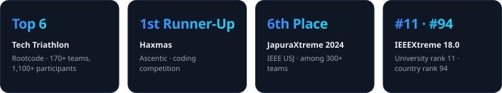
  </picture>

<b>More competitions &amp; learning</b>

 

- **Yarl Geek Challenge** (Startup/Innovation Pitch): shortlisted and competed in the final round in Jaffna
- **CodeSprint** (Innovation Competition): shortlisted for the semi-final stage with an MVP for public bus transportation
- **SLIIT AI Sprint** (Sysco Labs): built an MVP for Sysco Sales consultants
- **Participant:** Predicta (AI Prediction Challenge, IEEE UoP) and CodeRally Coding Competition (IEEE Computer Society)
- **Kaggle competitions:** Backpack Prediction, Insurance Regression, House Price Prediction, Titanic, Spaceship Titanic
- **Courses:** Anthropic (Claude Code 101), Udemy (Large Language Models), Kaggle (Intermediate ML, Pandas, Python), and LinkedIn Learning (RAG and Fine-Tuning, Docker for Developers, React, JavaScript, NoSQL, R for Data Science, ML with Python, AWS, SQL, Generative AI, and more)

 

## Beyond the Code

<a href="https://www.youtube.com/@DataSciencewithSaqib1"><picture>
    <source media="(prefers-color-scheme: dark)" srcset="./assets/beyond-dark.svg">
    <source media="(prefers-color-scheme: light)" srcset="./assets/beyond-light.svg">
    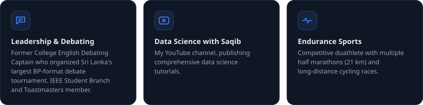
  </picture></a>

 

## Connect

<a href="mailto:saqibshouqi@gmail.com"></a>

